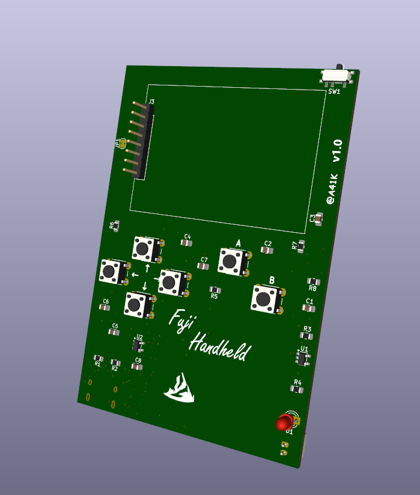
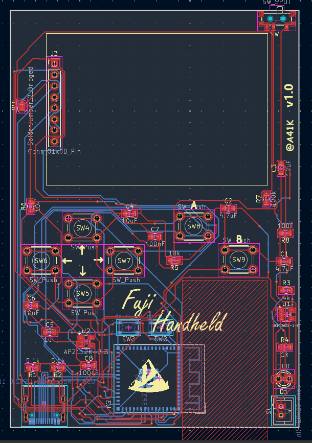
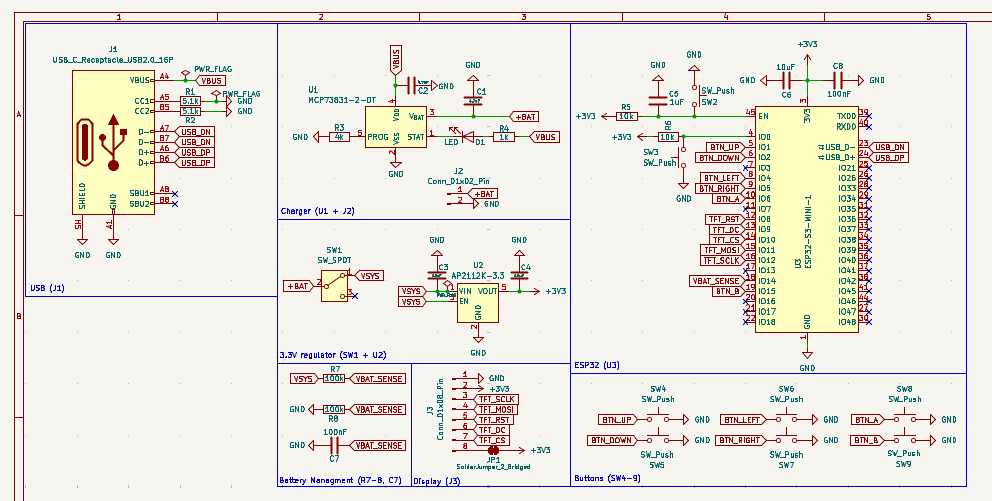

## Fuji Handheld
- A small pocket sized gameboy ask console with controls, 2.0' TFT screen, 2 pre-made games and a usb port

## PCB

## Schematic

## Software

The software can be found in the /Firmware file

The pre programmed two games (pong, snake) can be found in the /games folder

everything can be changed around according to the MCU.
